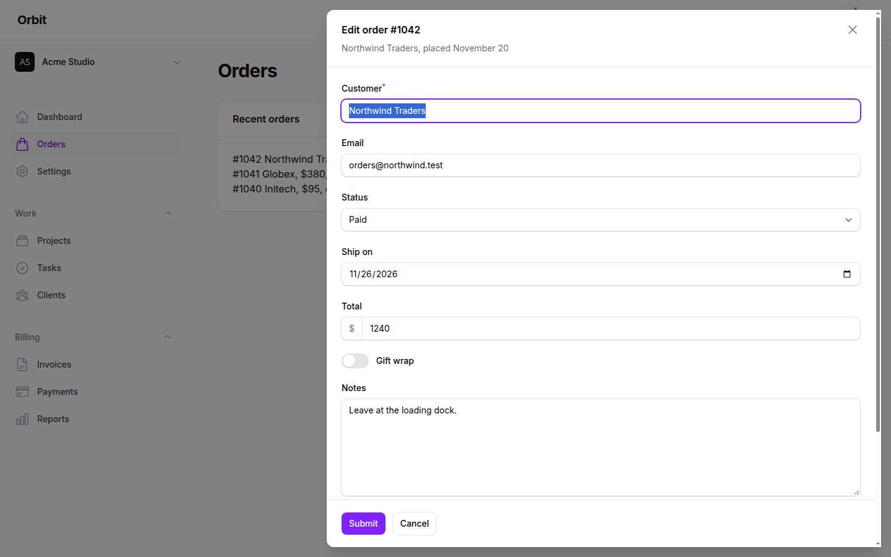

# Detached Slide-Overs for Filament

[](https://packagist.org/packages/filafly/filament-detached-slide-overs)
[](https://packagist.org/packages/filafly/filament-detached-slide-overs)

Slide-overs that float off the edge of the screen. Instead of a full-height panel stuck to the side, a slide-over opens as a rounded card with a little of the page showing around it, the same shape as Filament's centered modals.

It's the slide-over from [Lucent](https://filafly.com/themes/lucent?utm_source=github&utm_medium=readme&utm_campaign=detached), FilaFly's premium theme, pulled out so it works in any panel and with any theme.



## Requirements

- PHP 8.2+
- Filament 4.11+ or 5.6+, the releases that added left and right slide-overs (tested with 4.13 on Laravel 12 and 5.11 and 5.12 on Laravel 13)

## Installation

You can install the package via Composer:

```bash
composer require filafly/filament-detached-slide-overs
```

Not sure which Laravel and PHP versions your Filament version needs? See the [Filament version compatibility guide](https://filafly.com/guides/filament-version-compatibility).

Publish the assets:

```bash
php artisan filament:assets
```

There are two ways to use it: detach one action at a time, or every slide-over in a panel.

## One action at a time

Call `detached()` on any action. It opens the action in a slide-over, so you don't need `slideOver()` as well.

```php
use Filament\Actions\Action;

Action::make('edit')
    ->detached()
    ->schema([
        // ...
    ])
```

That's all it takes: no plugin to register. It works on page header actions, table actions and actions in forms and infolists, and with `slideOverPosition()` for slide-overs that open from the left.

If you set `extraModalWindowAttributes()` on the same action, pass `merge: true` or call it before `detached()`, so it doesn't replace the class `detached()` adds.

## Every slide-over in a panel

Register the plugin in your panel provider:

```php
use Filafly\DetachedSlideOvers\DetachedSlideOversPlugin;

public function panel(Panel $panel): Panel
{
    return $panel
        ->plugin(DetachedSlideOversPlugin::make());
}
```

Now every slide-over in that panel is detached: actions that call `slideOver()`, and the slide-overs Filament draws itself, such as the database notifications panel. Centered modals are left as they are.

To keep one slide-over on the edge of the screen, call `detached(false)` on its action:

```php
Action::make('history')
    ->slideOver()
    ->detached(false)
```

### `everywhere(bool $condition = true)`

Pass `false` to register the plugin for its `gap()` and `radius()` settings only, and detach just the actions that call `detached()`.

## Spacing and corners

### `gap(?string $gap)`

The space between the slide-over and the edges of the screen, as a CSS length. Defaults to `0.5rem` on phones and `1rem` from the `sm` breakpoint (`40rem`) up. A gap you set is used at every size.

### `radius(?string $radius)`

The corner radius, as a CSS length. Defaults to `0.75rem`, the radius of Filament's centered modals.

```php
DetachedSlideOversPlugin::make()
    ->gap('1.5rem')
    ->radius('1rem')
```

Both are CSS custom properties, so a theme can set them instead:

| Property | Default | Purpose |
| --- | --- | --- |
| `--fi-detached-slide-over-gap` | `0.5rem`, `1rem` from `sm` | Space to the screen edges |
| `--fi-detached-slide-over-radius` | `0.75rem` | Corner radius |

```css
:root {
    --fi-detached-slide-over-gap: 1.25rem;
}
```

## How it looks

- The slide-over keeps its width (`modalWidth()`), header, footer and sticky header and footer. Its corners clip whatever scrolls inside it.
- It slides all the way in from off screen and back out, past the gap, in both left-to-right and right-to-left layouts.
- On phones it fills the screen apart from the gap, so the page stays visible at the edges.
- It follows light and dark mode, since it only changes the slide-over's position and shape, not its colors.

## Testing

```bash
composer test
```

## From FilaFly

This slide-over comes from Lucent, a premium Filament theme with a clean, minimal look for the whole panel: sidebar, tables, forms, widgets and notifications. [See Lucent](https://filafly.com/themes/lucent?utm_source=github&utm_medium=readme&utm_campaign=detached).

## Credits

- [Nolan Nordlund](https://github.com/nolanos)

## License

The MIT License (MIT). Please see [License](LICENSE.md) for more information.
